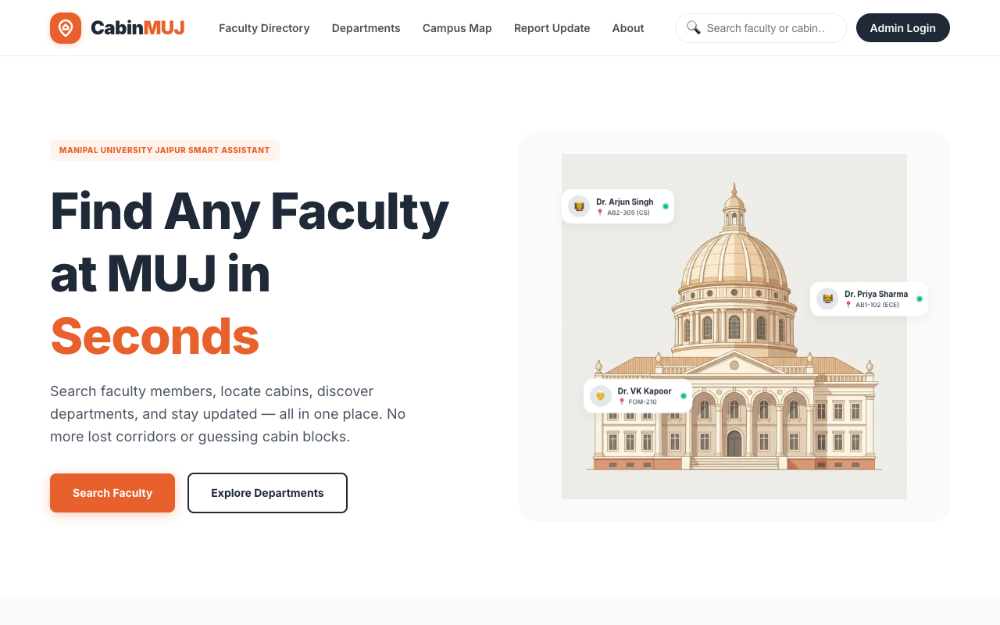
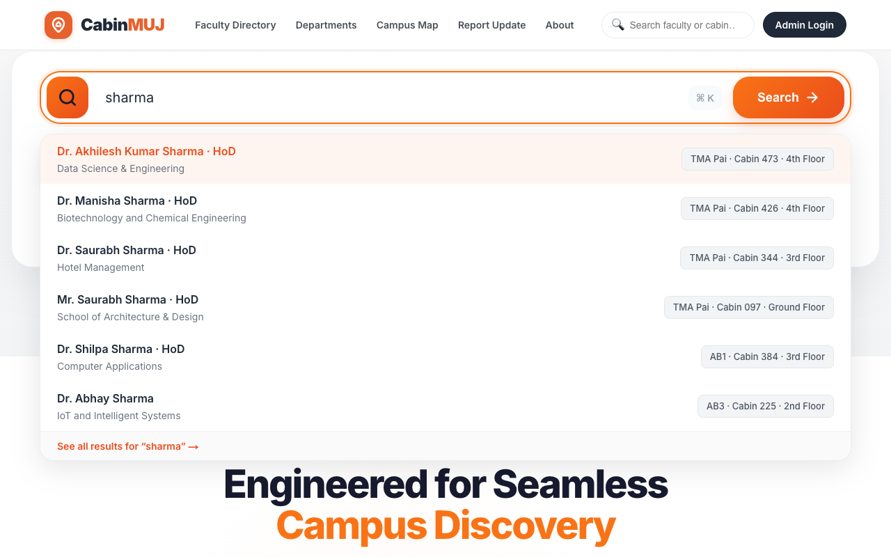
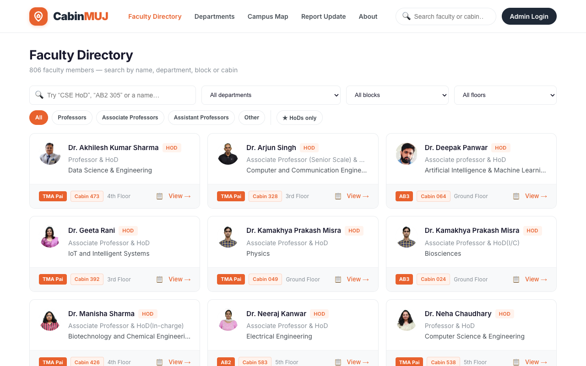
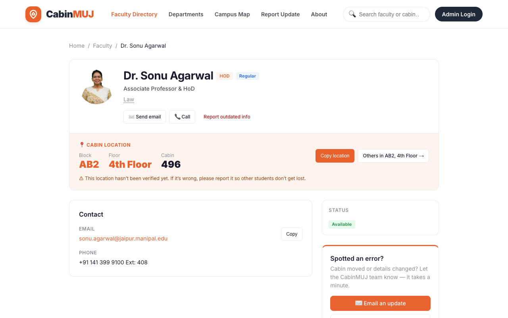
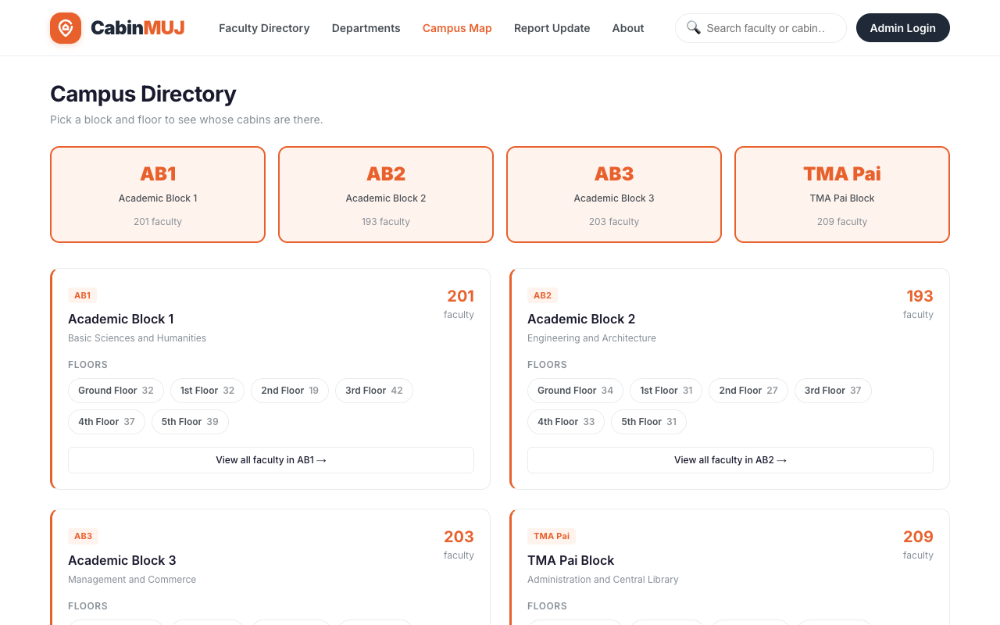
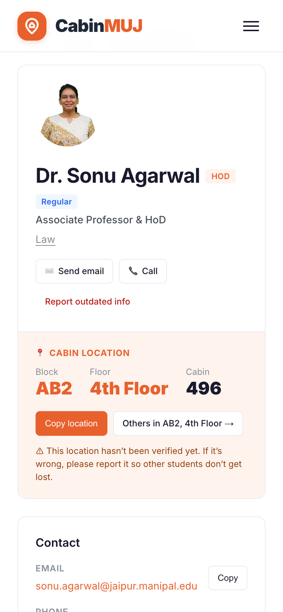
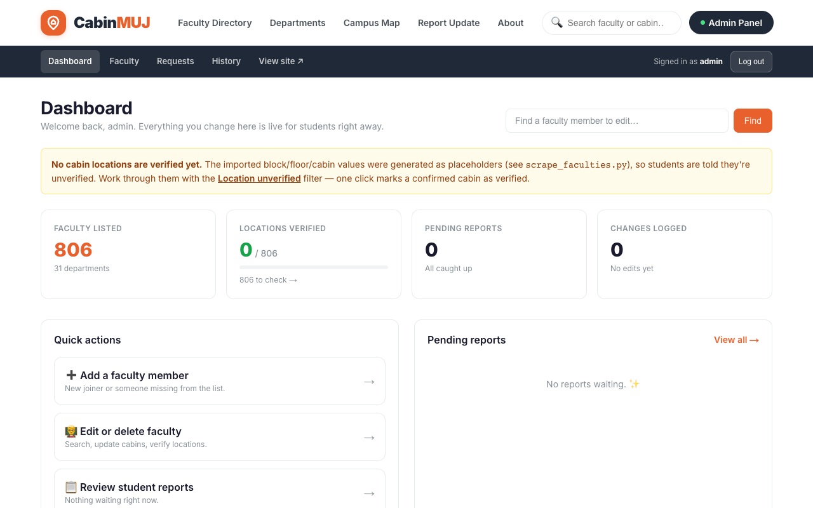
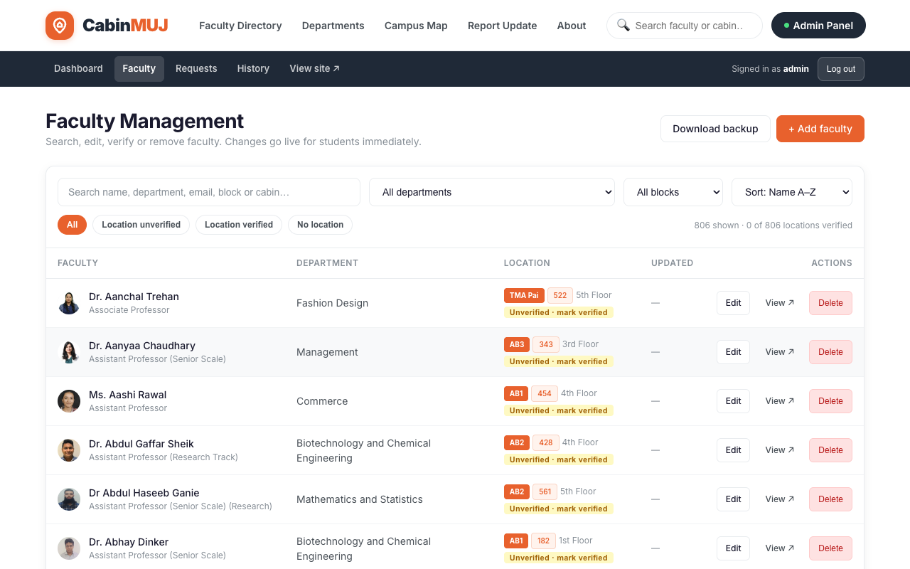
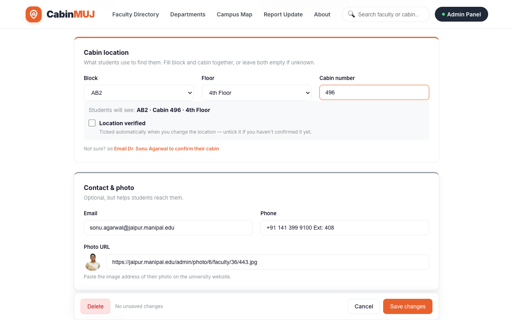

# CabinMUJ

Find any Manipal University Jaipur faculty member — and their block, floor and cabin — in seconds.
Students search and browse; an admin keeps the data accurate.

## Screenshots

### For students

<table>
  <tr>
    <td width="50%"><br><sub><b>Home</b> — find any faculty member in seconds</sub></td>
    <td width="50%"><br><sub><b>Live search</b> — suggestions with block, cabin and floor as you type</sub></td>
  </tr>
  <tr>
    <td><br><sub><b>Faculty directory</b> — filter by department, block, floor, designation or HoD</sub></td>
    <td><br><sub><b>Faculty profile</b> — cabin location first, plus contact and "report an update"</sub></td>
  </tr>
  <tr>
    <td><br><sub><b>Campus map</b> — browse each block floor by floor</sub></td>
    <td align="center"><br><sub><b>On a phone</b></sub></td>
  </tr>
</table>

### For the admin

<table>
  <tr>
    <td width="50%"><br><sub><b>Dashboard</b> — verification progress, student reports, recent changes</sub></td>
    <td width="50%"><br><sub><b>Faculty management</b> — search, edit, verify or delete</sub></td>
  </tr>
  <tr>
    <td colspan="2" align="center"><br><sub><b>Editor</b> — update a cabin; students see the change right away</sub></td>
  </tr>
</table>

## Quick start

```bash
npm install
cp .env.example .env.local   # then fill in the admin username and password
npm run dev                   # http://localhost:3000
```

- Public site: `/`, `/faculty`, `/departments`, `/blocks`, `/report`, `/about`
- Admin panel: `/admin` (sign in with the credentials from `.env.local`)

## Configuration (`.env.local` or your host's environment)

| Variable | Required | Purpose |
| --- | --- | --- |
| `ADMIN_USERNAME`, `ADMIN_PASSWORD` | yes | Admin login. The username is case-insensitive. |
| `ADMIN_SESSION_SECRET` | **yes on Vercel** | Signs the admin session cookie — any long random string (`openssl rand -hex 32`). Locally, if unset, one is generated and kept in `data/.session-secret`. Changing it signs everyone out. |
| `UPSTASH_REDIS_REST_URL`, `UPSTASH_REDIS_REST_TOKEN` | **on Vercel** | Store the data in Upstash Redis instead of a local file. Added automatically when you connect Upstash in Vercel (Vercel's `KV_REST_API_URL` / `KV_REST_API_TOKEN` names work too). |
| `NEXT_PUBLIC_CONTACT_EMAIL` | no | Where students' "Email an update" messages go (default `cabinmuj@gmail.com`). |
| `CABINMUJ_DATA_DIR` | no | Folder for the data file when Redis isn't used (default `./data`). |

Credentials are only ever read on the server; they are never sent to the browser. Keep them out of git
(`.env*` files are ignored, except `.env.example`).

## Admin panel

- **Dashboard** — totals, how many cabin locations are verified, pending student reports, recent changes.
- **Faculty** — search/filter all faculty; add, edit or delete; one-click "mark location verified".
  The editor warns about unsaved changes, detects edits made in another tab, flags likely duplicates,
  and supports Ctrl/⌘ + S. Deleting can be undone (toast "Undo", or **History → Restore**).
- **Requests** — reports students send from the update form. "Open in editor" shows the report next to
  the record; saving resolves it. You can also reject/reopen, and reply to the student by email.
- **History** — every change with before/after values.
- **Data & backups** (on the dashboard) — download all data as JSON, or restore from such a file
  (also how you move data to a new server).

Every admin page and server action verifies the session on the server. "Log out" signs the admin out on
every device. Failed logins and public report submissions are rate-limited per address and site-wide (so
faking an address doesn't help), and every input is validated on the server.

## Data

All data (faculty, student reports, change history) is one JSON document, stored:

- **on Vercel — in Upstash Redis**, used automatically when its environment variables are set. Each server
  instance keeps a copy in memory and only checks a tiny version key (students may see an edit up to ~10 s
  late; admins always see fresh data). Saves are atomic, so simultaneous saves never overwrite each other.
- **locally or on a server with a disk — in `data/cabinmuj-db.json`**, written atomically with the
  previous version kept as `cabinmuj-db.json.bak`.

It is created on the first run from `src/lib/mock-data.ts`; after that **the admin panel is the source of
truth** — edit faculty there, not in `mock-data.ts`. The dashboard shows where the data is stored.

> **Cabin locations in the seed data are placeholders.** `scrape_faculties.py` scraped names, designations,
> departments and photos from the MUJ website but assigned block/floor/cabin **at random**. Every record
> therefore starts as "unverified" (students see a notice). Use **Faculty → Location unverified** in the
> admin panel to confirm or correct them. Re-running the script regenerates random cabins in
> `mock-data.ts` (it does not touch the live data file).

## Deploying on Vercel (recommended)

1. **Import the repository** at [vercel.com/new](https://vercel.com/new) — the Next.js defaults are fine.
2. **Add the database:** in the project, open **Storage** → create an **Upstash for Redis** database on the
   free plan and connect it to this project (Vercel adds its connection settings automatically).
   - Leave **Eviction off** — Redis is the app's database here, not a cache.
   - When connecting, set **Custom Prefix** to `KV` (the app also recognizes other prefixes).
   - Tip: choose the **Mumbai** region, and set the project's function region to Mumbai (`bom1`) under
     **Settings → Functions**, so pages load fast for students in India.
3. **Add environment variables** (**Settings → Environment Variables**): `ADMIN_USERNAME`,
   `ADMIN_PASSWORD` and `ADMIN_SESSION_SECRET` — you can paste those three lines from your `.env.local`.
4. **Redeploy** (**Deployments → ⋯ → Redeploy**) so the new settings take effect.
5. **Move your data:** on your local copy open **Admin → Dashboard → Download backup**; on the live site
   open **Admin → Dashboard → Restore from a backup file** and upload it.

If the dashboard says saving is turned off, step 2 or 4 is missing; the login page names any missing
variable.

## Other hosts

Any Node.js host with a **persistent disk** works without Redis — a VPS, a Docker container with a
volume, Railway, Render or Fly.io:

```bash
npm ci && npm run build
ADMIN_USERNAME=… ADMIN_PASSWORD=… ADMIN_SESSION_SECRET=… npm start
```

Without Redis, run **one** server process (no cluster mode / replicas): saves are serialized and rate
limits are counted inside the process. Behind a reverse proxy, have it set `X-Real-IP` so per-address
limits see real client addresses.

## Project structure

```
src/app/                 pages (public site, /admin, /admin/export)
src/components/          UI (admin/, faculty/, home/, layout/, report/, ui/)
src/lib/actions/         server actions (admin edits, public reports)
src/lib/server/          storage, session/auth, validation, rate limiting (server-only)
src/lib/                 shared types, search, formatting, mailto helpers
```

Scripts: `npm run dev`, `npm run build`, `npm start`, `npm run lint`.
